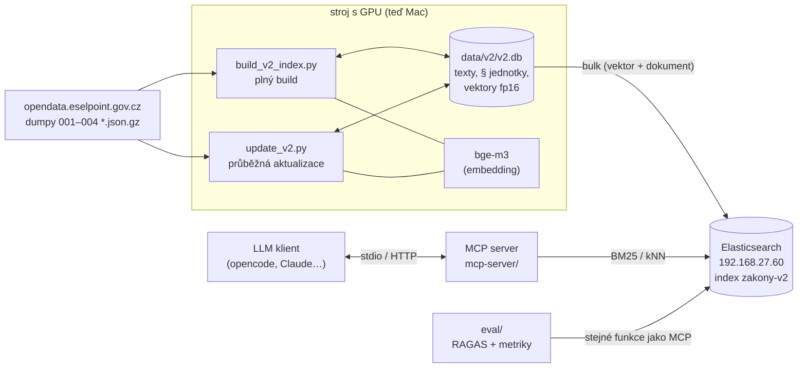

# Architektura: jak funguje kód

Popis kódu indexu v2, aktualizace, MCP serveru a evaluace. Provoz (nasazení, kontrola, rollback):
[`PROVOZ.md`](PROVOZ.md). Návrh indexu, důvody a výsledky: [`INDEX_V2.md`](INDEX_V2.md).

## Přehled



- **Lokální DB je zdroj pravdy.** ES se z ní dá kdykoli znovu naplnit bez embeddingu (`build_v2_index.py push`).
- Embedding dokumentů běží jen při buildu/aktualizaci na GPU; MCP embeduje jen krátký dotaz (CPU stačí).

## Zdrojová data (e-Sbírka, opendata)

| dump | co obsahuje | co z něj bereme |
|---|---|---|
| `001PravniAktZneni` (~170 MB) | **znění** předpisů (verze v čase) | citace, název, `znění-dokument-id`, IRI znění, účinnost od/do, typ znění (`KONSOL` / `VYHLZNE`), čas poslední změny |
| `002PravniAkt` (~5 MB) | předpisy (akty) | zatím nepoužíváme (jen se stahuje pro úplnost) |
| `003PravniAktZneniFragment` (~1,2 GB) | **strom fragmentů** každého znění | IRI fragmentu s cestou (`/dokument/norma/cast_2/…/par_140/odst_1`), rodič, pořadí (`hierarchie-hex`), odkaz na text |
| `004PravniAktFragment` (~0,5 GB) | **texty a typy** fragmentů | `fragment-text`, typ (`Paragraf`, `Clanek`, `Nadpis_pod`, `Odstavec_Dc`, `Pismeno_Lb`, …) |

Soubory jsou JSON `{"položky": [...]}` v gzipu; čtou se proudově (`ijson`), celé se do paměti nenačítají.

## Moduly

| soubor | role | hlavní funkce |
|---|---|---|
| `scripts/v2_common.py` | sdílená logika indexu v2 | `units_for_law` (strom fragmentů → § jednotky), `law_type`, `priority`, `is_republication`, `search_text_of`, `MAPPING` (ES) |
| `scripts/build_v2_index.py` | plný build a obsluha DB/ES | fáze `extract` / `units` / `embed` / `push` / `backup` / `stats`; `read_versions`, `choose_versions`, `extract_fragments`, `extract_texts`, `law_units`; třídy `Embedder`, `ESPusher` |
| `scripts/update_v2.py` | průběžná aktualizace | `download_dumps`, `plan_changes`, `rebuild_laws`, `remove_laws`, `sync_es`, `run_update` |
| `scripts/run_v2_overnight.sh` | noční build | extract → units → embed (restarty při kódu 75) → push → backup → stats → eval |
| `mcp-server/main.py` | MCP + FastAPI server | načítání modulů z `modules/`, transporty stdio / HTTP (`/mcp`, `/sse`), Swagger `/docs`, `/metrics` |
| `mcp-server/modules/ESZakony/main.py` | nástroje nad ES | `search_laws_text`, `search_laws_semantic`, `get_law_detail`; v2: `_v2_bm25_hits`, `_v2_knn_hits`, `_v2_rescore`, `_v2_group`, `_v2_law_detail` (v1 jen pro historii) |
| `mcp-server/run_mcp.sh` | spuštění MCP (stdio) | `ES_INDEX=zakony-v2`, offline režim modelu při celých vahách |
| `eval/` | evaluace kvality vyhledávání | `retrievers.py` (varianty vyhledávání), `run_eval.py` (metriky + RAGAS), `build_dataset.py`, `config.py`, golden sady v `eval/data/` |
| `scripts/pipeline.py`, `embed_and_push.py`, `push_to_es.py`, `import_esbirka.py` | původní pipeline v1 | nepoužívá se (index v1 smazán) |

## Tok dat

### Plný build (`build_v2_index.py`, ~4 h)

1. **extract** – `read_versions` (001) → `choose_versions(datum)` vybere u každého předpisu znění k datu →
   tabulka `laws`; `extract_fragments` (003) a `extract_texts` (004) jen pro vybraná znění → `frag`, `text`.
2. **units** – `law_units` → `units_for_law` postaví § jednotky → tabulka `units` (dokument jako JSON).
3. **embed** – `Embedder` (bge-m3, fp16, GPU) zembeduje `search_text`; vektor se **nejdřív uloží do `vectors`**,
   pak `ESPusher` pošle dávku do ES (`pushed = 1`). Výpadek ES embedding nezastaví.
4. **push / backup / stats** – dorovnání do ES, kopie DB, přehled.

### Průběžná aktualizace (`update_v2.py`, minuty)

1. `download_dumps` – stáhne jen novější dumpy (`Last-Modified`), přes `.part` a atomické přejmenování.
2. `choose_versions(dnešek)` → `plan_changes(DB, cíl)`: **new** (předpis v DB není), **changed** (jiné IRI znění,
   jiný dokument téhož znění, jiný čas poslední změny, jiný status/název/typ/priorita), **removed** (v cíli chybí =
   zrušený / přetisk), **baseline** (první běh: jen doplnit čas změny, nic nepřepočítávat).
3. `rebuild_laws` – fragmenty jen pro new + changed, nové § jednotky; vektor podle `sha1(search_text)`
   z `vec_by_hash`, jinak embedding (`Embedder.plan` / `encode`); staré jednotky předpisu se nahradí,
   nové mají `pushed = 0`; předpis se zapíše do `es_pending_delete`.
4. `remove_laws` – smaže jednotky, vektory a fragmenty zrušených předpisů; `es_pending_delete` s `NULL`.
5. `sync_es` – `ESPusher.push_all` pošle čekající dokumenty, `refresh`, a teprve pak pro každý předpis
   v `es_pending_delete` `delete_by_query`: dokumenty předpisu **mimo jeho aktuální § jednotky** (nebo všechny
   u zrušeného). Při chybě ES zůstane záznam v `es_pending_delete` a další běh ho dokončí.

### Dotaz přes MCP (`search_laws_semantic`)

dotaz → `get_embedder().encode` (bge-m3, normalizovaný vektor) → `_v2_knn_hits`: kNN na `vektor`, k = max(50, 5 × size),
filtr `status != zruseny` → `_v2_rescore`: přetisky „úplné znění“ ven, `status = neznamy` a `rok < 1945` × 0,94 →
`_v2_group`: top `size` dokumentů seskupených podle předpisu.

`search_laws_text` je stejné s BM25 (`multi_match` přes `nadpis^3`, `cesta^1,5`, `akt_nazev^0,5`, `text`);
`get_law_detail` vrátí všechny § předpisu seřazené podle `poradi` (přijímá IRI i citaci).

Výstup vyhledávání:

```json
{"total_hits": 50, "results": [{
  "id_zakona": "esel-esb:eli/cz/sb/2009/40", "akt_citace": "40/2009 Sb.", "akt_nazev": "Zákon trestní zákoník",
  "rok": 2009, "status": "platny",
  "relevant_paragraphs": [{"citace": "§ 140 Vražda", "cesta": "ČÁST DRUHÁ … › Díl 1 Trestné činy proti životu",
                           "text": "(1) Kdo jiného úmyslně usmrtí …", "score": 0.82}]}]}
```

## Lokální DB `data/v2/v2.db` (SQLite)

| tabulka | sloupce | význam |
|---|---|---|
| `laws` | `akt_citace` PK, `nazev`, `status` (platny/neznamy), `doc_id`, `zneni_iri`, `ucinnost_od`, `typ`, `priority`, `units_done`, `zneni_zmena` | vybrané znění každého předpisu = co je v indexu |
| `frag` | `doc_id`, `iri`, `parent`, `hex`, `frag_id` | strom fragmentů vybraných znění (z 003) |
| `text` | `frag_id` PK, `typ`, `text` | texty a typy fragmentů (z 004) |
| `units` | `id` PK (= `_id` v ES), `akt_citace`, `priority`, `len`, `doc` (JSON dokumentu bez vektoru), `embedded`, `pushed` | § jednotky; `embedded` = vektor je lokálně, `pushed` = dokument je v ES |
| `vectors` | `id` PK, `v` (fp16, 1024 × 2 B) | vektor ke každé jednotce |
| `vec_by_hash` | `h` PK (sha1 `search_text`), `v` | vektory podle obsahu – převzetí při aktualizaci |
| `es_pending_delete` | `akt_citace` PK, `keep_zneni_iri` | předpisy, jejichž staré dokumenty v ES čekají na smazání |
| `update_log` | `ts`, `date`, `summary` (JSON) | historie aktualizací |
| `meta` | `key`, `value` | `extract_done` = datum, ke kterému jsou znění vybrána |

Indexy: `idx_frag_doc`, `idx_units_todo (embedded, priority, len)`, `idx_units_push (embedded, pushed, priority)`.
Schéma se rozšiřuje automaticky (`build_v2_index.db()`, `update_v2.ensure_schema`).

## Dokumenty v ES

Jeden dokument = jeden § / článek (nebo text mimo §) aktuálního znění; dlouhé § rozdělené po odstavcích do
1 800 znaků. Pole a typy: [`INDEX_V2.md` → Schéma dokumentu](INDEX_V2.md#schéma-dokumentu), mapping v
`v2_common.MAPPING` (analyzátor `czech`, `vektor` = `dense_vector` 1024, `int8_hnsw`, cosine).

- `_id` = IRI § v daném znění + `#číslo chunku`, např. `…/sb/2009/40/2026-01-01/dokument/norma/…/par_140#0`
  → nové znění má nová `_id`, takže může v indexu chvíli existovat vedle starého (aktualizace bez výpadku).
- `_source` neobsahuje `vektor` ani `search_text` (šetří disk a RAM serveru); `search_text` jde zrekonstruovat
  (`search_text_of`).

## Klíčové algoritmy

- **Výběr znění** (`choose_versions`): konsolidované znění (`KONSOL`) účinné k datu → `platny`; všechna KONSOL
  skončila → zrušený (vynechat); jen vyhlášené znění → `neznamy`; název „Úplné znění …“ → vynechat. Při víc
  zněních se stejným datem účinnosti rozhoduje `_version_key`: datum → nejnovější změna v datech → číslo
  dokumentu (výsledek nezávisí na pořadí v dumpu).
- **§ jednotky** (`units_for_law`): fragmenty seřazené podle `hex`; jednotka = první `par_*` / `cl_*` v cestě
  (citované § v novelách patří k vnějšímu); hlavička = název předpisu + cesta kontejnerů (`ČÁST › HLAVA › Díl`
  s nadpisy) + označení a nadpis §; text mimo § se seskupí podle nejbližšího kontejneru; přeskakují se technické
  uzly a poznámky pod čarou.
- **Priorita** (`priority`): 0 platné zákony, 1 nařízení, 2 vyhlášky, 3 ostatní platné, 4–5 `neznamy`,
  8 mezinárodní smlouvy (`Sb. m. s.`). Indexuje se `<= 5`.
- **Embedding** (`Embedder`): bge-m3 fp16; délky zarovnané na koše po 64 tokenech a pevná velikost dávky →
  jen 8 tvarů vstupu (jinak MPS neuvolňuje cache a paměť roste do OOM); při OOM / překročení limitu kód 75 →
  restart procesu.
- **Filtr nejistých předpisů** (`_v2_rescore` v MCP): přetisky ven, `neznamy` a před 1945 × 0,94 nad poolem 50.

## MCP server

`mcp-server/main.py` načte moduly z `modules/` (pořadí podle `depends_on`), zaregistruje jejich nástroje do FastMCP
a zároveň jako REST endpointy FastAPI (Swagger na `/docs`). Přes `run_mcp.sh` běží na **stdio** (klient si ho
spouští sám), přes `python main.py` na **HTTP** `0.0.0.0:8000` (`/mcp/` Streamable HTTP, `/sse`).
`modules/ESZakony/main.py` volí schéma podle `ES_INDEX` (`zakony-v2*` → v2; v1 jen pro historii).

## Evaluace (`eval/`)

- `retrievers.py` – `retrieve(name, query, k)`: `bm25` / `hybrid` = skutečné nástroje MCP, `v2-bm25`, `v2-knn`,
  `v2-hybrid` (RRF), `v2-rerank`, `v2-knn-f1…f5` (varianty filtru); `v1-*` jen historicky.
- `run_eval.py` – deterministické metriky (hit@k, MRR, správný předpis, prázdné / nejisté kontexty, latence)
  a RAGAS (context precision / recall, volitelně faithfulness, relevance, factual correctness) s LLM soudcem
  Qwen za VPN. Shoda s gold = správný předpis + kotva (fráze z textu).
- `eval/data/` – golden sady: 15 ručních, 3 kontrolní na staré platné zákony, 20 syntetických (`build_dataset.py`).
- Podrobně: [`eval/README.md`](../eval/README.md).

## Testy

| soubor | co hlídá |
|---|---|
| `scripts/tests/test_build_v2_index.py` | pevné tvary dávek, restart při paměti GPU, výpadek ES, obnova `push`, záloha, ochrana data znění |
| `scripts/tests/test_update_v2.py` | aktualizace nad miniaturními dumpy: nový / novelizovaný / zrušený předpis, oprava dat, převzetí vektorů, idempotence, výpadek ES bez výpadku indexu, dry-run, výběr verzí |
| `mcp-server/tests/test_eszakony.py` | v1/v2 schéma, výchozí index, deduplikace v1, kNN, filtr starých předpisů, `get_law_detail` |
| `mcp-server/tests/test_run_mcp_sh.py` | offline režim modelu jen při celých vahách |

Spuštění: [README → Testy](../README.md#-testy). Všechny testy běží bez sítě, GPU i modelu.
